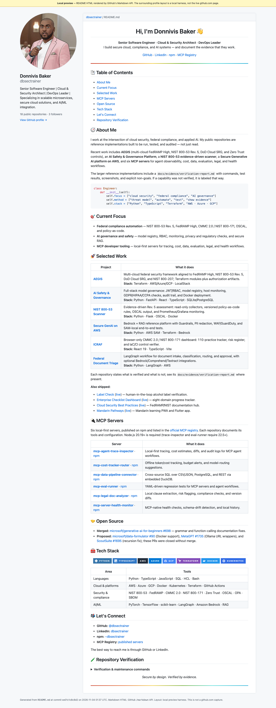
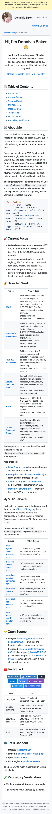
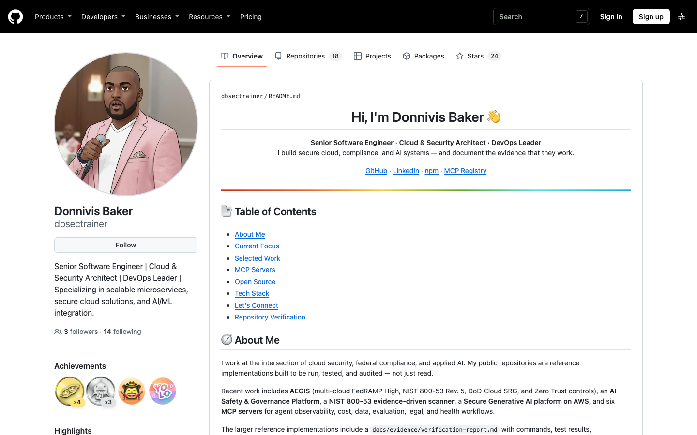

# GitHub Profile Audit — Verification Report

**Repository:** [`dbsectrainer/dbsectrainer`](https://github.com/dbsectrainer/dbsectrainer)
**Profile:** <https://github.com/dbsectrainer>
**Audit date:** 2026-11-03 (America/New_York)
**Base commit:** `ee01c1c8c8d2a0a15fb928e5febfa04acc2273fb`
**Deployed commit:** `9e7a61113eb45e2483ce63fb194dbebbf8987deb` (PR #3, squash merge)
**Live verification:** 2026-11-04 (UTC)
**Final status:** **PARTIAL PASS**

---

## 1. Executive summary

This repository is the source of a **GitHub profile README**, not a deployable application. The
profile has no server, database, package manifest, or build step: GitHub renders `README.md`
directly. The audit therefore treated the rendered GitHub profile as the application and verified
the things that can actually break it: content accuracy, links, anchors, badges, images, heading
structure, accessibility, responsive layout, and the published tools the profile advertises.

The profile was in poor repair:

- three links returned HTTP 404;
- the contact and support sections still contained template placeholders;
- two upstream contributions were described as merged when the pull requests were closed
  without merge;
- the table of contents did not reliably scroll on the desktop GitHub profile page;
- the project list was stale and omitted every repository created in 2026;
- six SVG files were unreferenced legacy assets;
- there was no test, validation, or CI setup;
- and all six MCP packages advertised with `npx` commands fail to start from the published npm
  tarballs because `yargs` is not declared as a runtime dependency.

The README was rewritten with current projects, accurate contribution status, working contact
links, explicit anchors, and a two-column project table. A reproducible validation harness,
unit tests, GitHub Actions workflow, local GitHub-Markdown preview, and Playwright screenshot
pipeline were added.

The update was published through the repository's required pull-request workflow: a direct push
to `main` was rejected by the branch ruleset, the commit was moved to `profile-audit-2026-11`,
PR #3 passed its `validate` check, and the PR was squash-merged as `9e7a611`. The live profile was
then verified directly on github.com.

One external blocker remains:

1. **The six npm MCP tarballs are stale.** The source repositories are newer and, in at least
   one case, already contain the dependency fix; the published `1.0.0` tarballs do not. No npm
   credentials are available in this environment to republish them. The profile no longer
   advertises the broken commands, and the exact remediation is documented below.

The profile source, deployment, and rendering pass every profile-level check. The final verdict
is **PARTIAL PASS** because the advertised MCP packages still fail when installed from npm; that
requires an npm republish outside this repository.

---

## 2. Audit scope and methodology

### In scope

- `README.md` and the six legacy SVG files in the repository root.
- The live profile page at <https://github.com/dbsectrainer> before changes.
- Every external link, badge, and image in the README.
- GitHub profile metadata (name, bio, public repositories).
- The six npm packages and official MCP registry entries named in the README.
- GitHub rendering of the updated README through `POST https://api.github.com/markdown`.
- Desktop (1440 × 900) and mobile (390 × 844) browser checks with Playwright.
- Accessibility with axe-core 4.10.3; console errors; failed requests; image loading; horizontal
  overflow.
- Repository documentation, tests, CI, and commit hygiene.

### Out of scope / not performed

- Modifying or publishing the six external MCP repositories.
- Publishing new npm versions.
- Changing GitHub profile settings (bio, pinned repositories, social links), which require the
  `user` scope and are not stored in this repository.
- Live cloud environments or production data. None of the linked projects was deployed or
  revalidated; the audit only verified the profile's claims against public repository metadata,
  READMEs, pull-request status, and npm/MCP registry listings.

### Method

1. Read the entire repository and inspected git history, including when and why the SVGs became
   unreferenced.
2. Compared the README with the live GitHub profile, the GitHub user API, and the public
   repositories API.
3. Checked every external URL with a browser user agent and recorded HTTP status. Links on
   LinkedIn and npm that intentionally block automation were separately reviewed and allowed
   with a documented reason.
4. Verified GitHub pull-request claims through the GitHub search and pull APIs.
5. Queried the npm registry and the official MCP registry for every advertised package.
6. Ran each published MCP package through an MCP `initialize` + `tools/list` handshake, then
   repeated the handshake with `yargs` supplied explicitly to isolate the failure.
7. Rendered the updated README through GitHub's Markdown API and verified all anchors.
8. Served the preview locally and ran Chromium and WebKit checks, including a real click on each
   table-of-contents link, image loading, console/network capture, axe-core, and a 390 px mobile
   layout.
9. Added regression tests and a CI workflow, then reran all checks.
10. Because the repository blocks direct pushes to `main`, moved the commit to a feature branch,
    opened PR #3, waited for the `validate` check to pass, and merged through the PR workflow.
11. Verified the published profile on github.com with a real browser, including H1 visibility,
    every TOC link, image loading, console/network activity, and the 390 px mobile layout.

Raw evidence is under [`docs/evidence/`](.):

- [`test-results/`](test-results/) — JSON and text results.
- [`build-results/`](build-results/) — GitHub API render, preview HTML, environment.
- [`screenshots/`](screenshots/) — desktop, mobile, section, and before screenshots.

---

## 3. Repository assessment

| Property | Finding |
| --- | --- |
| Repository type | GitHub profile README (`dbsectrainer/dbsectrainer`) |
| Stack | Markdown, HTML, SVG; Python 3.12 verification tooling |
| Entry point | `README.md`, rendered by GitHub |
| Application server | None |
| Build step | None; GitHub renders the Markdown |
| Package manager / lockfile | None originally; `requirements-dev.txt` added for the optional browser harness |
| Tests before audit | None |
| CI before audit | None |
| License | No repository license; profile content is personal, so no license was added |
| Public repositories | 18 at the time of audit |
| Live profile name/bio | Donnivis Baker; “Senior Software Engineer \| Cloud & Security Architect \| DevOps Leader \| Specializing in scalable microservices, secure cloud solutions, and AI/ML integration.” |

The README was 310 lines and the repository contained six SVGs that no longer appeared in any
README. Git history showed the diagrams were removed from the README in an earlier rewrite but
left in the repository root. They included a 2015–2023 career timeline and technology lists that
were not documented elsewhere.

The owner confirmed during the audit that `ai_cloud_dashboard` was deleted and that `controlplane`
will be updated separately by the owner. Both are therefore excluded from the current profile.
The `controlplane` GitHub Pages demo still returned HTTP 200, but the source repository returned
404 at audit time.

---

## 4. Findings and remediation

Severity reflects impact on a visitor or on the accuracy of the public profile.

| ID | Severity | Finding | Evidence | Resolution |
| --- | --- | --- | --- | --- |
| F-01 | Critical | Three README links returned 404: `ai_cloud_dashboard`, `controlplane`, and `microsoft/generativeai-for-beginners` (wrong slug; the real repository is `microsoft/generative-ai-for-beginners`). | [`baseline-link-check.txt`](test-results/baseline-link-check.txt) | Removed the deleted/private projects; fixed the Microsoft URL; owner confirmed `ai_cloud_dashboard` deletion and the pending `controlplane` update. |
| F-02 | Critical | Contact and support sections used template placeholders: `your.email@example.com`, `https://yourwebsite.com`, `https://www.buymeacoffee.com/yourusername`. The GitHub Sponsors URL redirected to the profile, so the account is not sponsorable. | [`baseline-placeholders.txt`](test-results/baseline-placeholders.txt) | Replaced with GitHub, LinkedIn, npm, and MCP registry links. Removed the fictional email, website, Buy Me a Coffee, and inactive Sponsors links. |
| F-03 | Critical | Every advertised MCP `npx` install command failed. Published `1.0.0` tarballs import `yargs`, which is absent from their `dependencies`. | [`mcp-runtime.json`](test-results/mcp-runtime.json), [`mcp-dependency-analysis.txt`](test-results/mcp-dependency-analysis.txt) | Removed the install-command column from the profile; kept repository and npm links. Documented the upstream release fix below. |
| F-04 | High | “Merged PRs”/“Enhanced” claims for Microsoft Data Formulator and MetaGPT were not merged. The Data Formulator Docker PR (#90), MetaGPT Ollama PR (#1735), and ScoutSuite PR (#1695) were all closed without merge. The Generative AI for Beginners PR (#698) was merged. | [`baseline-contribution-claims.json`](test-results/baseline-contribution-claims.json) | Rewrote the section as **Merged** vs **Proposed**, explicitly noting the three proposals were closed without merge. |
| F-05 | High | The original TOC relied on GitHub mapping `#-about-me` to the rendered `#user-content--about-me` anchor. On the desktop profile page the click changed the hash but did not scroll. | [`baseline-live-toc-desktop.json`](test-results/baseline-live-toc-desktop.json), [`baseline-live-toc.json`](test-results/baseline-live-toc.json) | Added explicit `<a id="…">` anchors and TOC links to the rendered `#user-content-…` IDs. Verified all 8 links with real clicks in the preview; verified the prefixed-anchor technique on the live GitHub profile by injecting a temporary link in the browser. |
| F-06 | High | The README described a “Full-Stack Developer & Technical Architect / AI/ML Security Engineer”, contradicting the public GitHub bio (“Senior Software Engineer / Cloud & Security Architect / DevOps Leader”). The project list was stale and the profile omitted all 2026 work. | Live profile and GitHub user API ([`baseline-contribution-claims.json`](test-results/baseline-contribution-claims.json)) | Aligned the headline and About section with the public bio; replaced the project list with current, verified repositories. |
| F-07 | Medium | Nested Markdown under *Enterprise Checklist Dashboard* rendered “Tech Stack:” and “Why it matters:” as continuations of the preceding bullet, producing a malformed block. | Pre-change live screenshot [`before/live-profile-desktop.png`](screenshots/before/live-profile-desktop.png) | Replaced the long nested project bullets with a two-column table and short stack lines. |
| F-08 | Medium | Heading hierarchy was H1 → H2 (Table of Contents) → H3 for every main section, so all content sections were semantically subordinate to the TOC. | Pre-change README | Main sections are now H2 with explicit anchors; one H1; heading-level jumps are checked by the validator. |
| F-09 | Medium | Six SVG diagrams were unreferenced and some contained unverified career/technology claims. | [`baseline-svg-references.txt`](test-results/baseline-svg-references.txt) (zero references) | Moved to [`docs/archive/legacy-svg/`](../archive/legacy-svg/) with an explanation; not part of the rendered profile. |
| F-10 | Medium | No tests, link checks, secret scan, accessibility check, or CI existed. | Repository inventory | Added a Python validator, 18 unit tests, GitHub Actions, Dependabot, preview renderer, and Playwright evidence harness. |
| F-11 | Low | The decorative rainbow image had `alt=""` and was auto-wrapped in a link by GitHub, producing an axe `link-name` serious violation. | First axe run in `test-results/axe-results.json` history; fixed result is zero violations | Gave the image the accessible name “Rainbow divider”. |
| F-12 | Medium | No mobile-specific layout check existed; project tables were long and dense. | Pre-change live mobile screenshot | Converted Selected Work to two columns, shortened descriptions, and added mobile checks for overflow, images, and tables. |
| F-13 | Low | The README contained trailing spaces used for visual line breaks and generic marketing metrics that could not be substantiated (“99.9% compliance”, “99.99% availability”, “80% reduction”, “Recognized in Cloud Computing Monthly”). | Pre-change README | Removed trailing whitespace and unverifiable claims; kept only claims backed by repository documentation. |

### Why the MCP finding does not contradict the source-repository validation

The owner noted that `mcp-agent-trace-inspector` was validated recently. That validation applies
to the **source repository**, not the published npm artifact:

| Package | npm `1.0.0` published | Source last pushed | `yargs` in published deps | `yargs` in current source |
| --- | --- | --- | --- | --- |
| `mcp-agent-trace-inspector` | 2026-03-23 | 2026-11-02 | No | Yes (runtime dependency) |
| `mcp-cost-tracker-router` | 2026-03-23 | 2026-09-28 | No | No (devDependency only) |
| `mcp-data-pipeline-connector` | 2026-03-23 | 2026-10-14 | No | No (devDependency only) |
| `mcp-eval-runner` | 2026-03-23 | 2026-10-05 | No | No (devDependency only) |
| `mcp-legal-doc-analyzer` | 2026-03-23 | 2026-09-28 | No | No (devDependency only) |
| `mcp-server-health-monitor` | 2026-03-23 | 2026-09-28 | No | No (devDependency only) |

The trace-inspector source already contains the fix, but the package version was not bumped or
republished after the source changed. `npx -y mcp-agent-trace-inspector` still installs the
March tarball. This is a release-engineering gap between source validation and the published
artifact, not a claim that the source repository failed its tests.

With `yargs` supplied explicitly and a writable database directory, **all six packages complete
an MCP initialize + `tools/list` handshake** (13, 15, 7, 10, 9, and 8 tools respectively). That
confirms the missing dependency is the startup blocker. Evidence:
[`mcp-workaround.json`](test-results/mcp-workaround.json).

---

## 5. Fixes implemented

### Profile content (`README.md`)

- Replaced the “Welcome to My Digital Universe” / “Full-Stack Developer” framing with the public
  professional identity and a concise mission statement.
- Removed the fictional email, website, Buy Me a Coffee, and Sponsors links. Added GitHub,
  LinkedIn, npm, and MCP registry links.
- Rewrote About, Current Focus, and Selected Work around current, public repositories:
  AEGIS, AI Safety & Governance, NIST 800-53 Scanner, Secure GenAI on AWS, ICRAF, and Federal
  Document Triage.
- Added a compact “Also shipped” list for Label Check, Enterprise Checklist Dashboard, Cloud
  Security Best Practices, and Mandarin Pathways, all with live demos where available.
- Replaced the MCP install table with repository + npm links. The profile no longer promises a
  command that fails.
- Rewrote Open Source as **Merged** and **Proposed**, with accurate merged/closed status.
- Replaced long nested project bullets with a two-column table and `<br>**Stack:**` lines.
- Added explicit anchors and `#user-content-…` TOC links so navigation does not depend on
  GitHub's client-side emoji-slug handling.
- Changed main section headings from H3 to H2.
- Gave the decorative divider a non-empty accessible name.
- Removed unverifiable percentages, recognition claims, and trailing whitespace.
- Added a collapsed **Repository Verification** section with reproducible commands and a link to
  this report.

### Repository and tooling

| File | Purpose |
| --- | --- |
| `tools/verify_profile.py` | Structural validator: placeholders, anchors, TOC, heading hierarchy, image alt text, local assets, secret patterns, archived SVG safety, external links, npm/MCP metadata. Writes JSON evidence. |
| `tools/render_preview.py` | Renders `README.md` through GitHub's Markdown API, verifies every TOC target, downloads the profile snapshot/avatar, and builds a self-contained preview. |
| `tools/capture_screenshots.py` | Playwright harness: desktop/mobile screenshots, image loading, console/network capture, real TOC clicks, mobile overflow, section crops, axe-core. |
| `tools/audit_mcp_packages.py` | Verifies npm maintainership and official MCP registry listings; optional published-command and `yargs`-workaround runtime probes. |
| `tools/mcp_packages.json` | Package inventory shared by the validator and MCP auditor. |
| `tools/vendor/github-markdown.css` | Vendored GitHub Markdown CSS (MIT) for the preview. |
| `tests/test_verify_profile.py` | 18 regression tests for the validator primitives. |
| `Makefile` | `check`, `test`, `validate`, `links`, `preview`, `screenshots`, MCP audit targets. |
| `requirements-dev.txt` | Playwright 1.55.0 and Pillow 10.4.0 for browser evidence. |
| `.github/workflows/profile-check.yml` | CI: unit tests + structural/link/MCP metadata validation on push and PR. Read-only permissions. |
| `.github/dependabot.yml` | Weekly GitHub Actions update PRs. |
| `.gitignore` | Python, virtualenv, node_modules, and artifact ignores. |
| `docs/archive/legacy-svg/` | The six legacy diagrams plus an explanation of why they are not current claims. |
| `docs/evidence/` | Screenshots, build output, test output, and this report. |

### Deliberately not changed

- The six external MCP repositories and their package manifests.
- The GitHub profile bio, pinned repositories, and social links. These are account settings, not
  repository content; the profile README now matches the existing bio.
- The `controlplane` and `ai_cloud_dashboard` entries. The owner confirmed the former will be
  updated separately and the latter was deleted.
- No repository license was added; the README is personal content, and a license choice was not
  requested.

---

## 6. Verification environment

| Component | Version |
| --- | --- |
| Host | macOS 27.0.1, arm64 |
| Python | 3.12.7 |
| Node.js | 26.13.0 |
| npm | 11.20.0 |
| Playwright | 1.55.0 |
| Chromium | 140.0.7339.16 (Playwright build 1187) |
| WebKit | Playwright build 2203 |
| Pillow | 10.4.0 |

Dependency installation was verified with `python3 -m pip install -r requirements-dev.txt`;
the pinned packages were already satisfied. See
[`dependency-install.txt`](build-results/dependency-install.txt).

No secrets or environment variables are required. No AWS, Azure, GCP, npm, or GitHub credentials
were used. `GITHUB_TOKEN` is optional for higher GitHub API rate limits during preview rendering;
it is not read from the repository.

---

## 7. Validation commands and results

### Unit tests

```text
$ python3 -m unittest discover -s tests -v
Ran 18 tests in 0.011s
OK
```

The tests cover TOC parsing, explicit-anchor mapping, missing-anchor detection, heading-level
jumps, image alt requirements, placeholder detection, trailing whitespace, and external URL
deduplication.

### README structure, links, and MCP metadata

```text
$ python3 tools/verify_profile.py --check-links --check-mcp
[PASS] no placeholder content
[PASS] no trailing whitespace
[PASS] TOC anchors resolve: 8 TOC links resolve to 8 anchors
[PASS] heading hierarchy and section anchors: 10 headings, one H1, every H2 anchored and in the TOC
[PASS] images have alt text: 10 images have alt attributes
[PASS] local assets and links exist
[PASS] no committed secrets
[PASS] archived SVG assets are well formed
[PASS] external links resolve: 44 external URLs checked; 9 allowed bot-blocked
[PASS] MCP package metadata: 6 packages found on npm and in the official MCP registry
10/10 checks passed
```

Link check notes:

- LinkedIn returns HTTP 999 and npm profile/package pages return HTTP 403 to non-browser clients.
  These hosts were reviewed individually and are allowed as bot-blocked, not treated as dead.
- The report link under `github.com/dbsectrainer/dbsectrainer/blob/main/` is mapped to the local
  file by the validator and marked “remote publish pending”. It becomes a normal 200 after the
  profile is pushed. The nine allowed entries are seven npm pages, one LinkedIn profile, and that
  local repository link.
- The baseline check found three 404s; the final check found none.

Artifacts:

- [`profile-validation.json`](test-results/profile-validation.json)
- [`final-check.txt`](test-results/final-check.txt)
- [`baseline-link-check.txt`](test-results/baseline-link-check.txt)

### GitHub Markdown rendering

```text
$ python3 tools/render_preview.py
GitHub Markdown API: HTTP 200; rendered 20968 bytes
Preview: docs/evidence/build-results/preview.html
TOC targets: 8; missing: 0
PASS: every TOC target exists in the GitHub-rendered HTML
```

This uses GitHub's actual `/markdown` API, so the HTML is produced by GitHub's parser and
sanitizer. It is not a hand-written mock. The surrounding page chrome is a local harness; the
deployed page is verified separately in **Live deployment verification** below. See
[`render-metadata.json`](build-results/render-metadata.json),
[`readme-rendered.html`](build-results/readme-rendered.html), and
[`preview.html`](build-results/preview.html).

### Browser and accessibility checks

```text
$ python3 tools/capture_screenshots.py
Desktop screenshot: docs/evidence/screenshots/homepage-desktop.png
Mobile screenshot:  docs/evidence/screenshots/homepage-mobile.png
TOC links checked:  8
Axe violations:     0 (0 serious/critical)

PASS: screenshots, images, TOC navigation, mobile layout, console, network, and axe checks
```

| Check | Result |
| --- | --- |
| Desktop viewport | 1440 × 900, full page 1440 × 3676 |
| Mobile viewport | 390 × 844, full page 390 × 5835, device scale 1 |
| Console errors | 0 desktop, 0 mobile |
| Failed requests | 0 desktop, 0 mobile |
| HTTP responses ≥ 400 | 0 desktop, 0 mobile |
| Images loaded | 11/11 desktop, 11/11 mobile |
| TOC links | 8/8 exist and scroll to their targets |
| Horizontal overflow | 0 px at 390 px |
| axe-core 4.10.3 | 0 violations (WCAG 2.0/2.1/2.2 A/AA tags) |
| Section crops | `selected-work.png` and `mcp-servers.png` |

Artifacts:

- [`screenshot-results.json`](test-results/screenshot-results.json)
- [`axe-results.json`](test-results/axe-results.json)

### Cross-browser check

- **Chromium 140:** pass, as above.
- **WebKit (Playwright build 2203):** pass; no console errors, no failed requests, no broken
  images, and the About Me TOC link scrolled to the target (`scrollY=659`). Screenshot:
  [`homepage-webkit-desktop.png`](screenshots/homepage-webkit-desktop.png).
- **Firefox:** could not launch in this environment. Playwright timed out with
  `sandbox initialization failed: Operation not permitted`. This is an environment/sandbox
  limitation, not a finding about the profile. Firefox remains unverified; see
  [`browser-matrix.json`](test-results/browser-matrix.json).

### MCP package audit

```text
$ python3 tools/audit_mcp_packages.py --metadata
6 packages found on npm and in the official MCP registry; all six are maintained by dbsectrainer.

$ python3 tools/audit_mcp_packages.py --runtime
0/6 packages completed the MCP handshake
Error [ERR_MODULE_NOT_FOUND]: Cannot find package 'yargs' ...

$ python3 tools/audit_mcp_packages.py --workaround
6/6 packages completed the MCP handshake
```

The published-command failure is reproducible and is not a test-harness artifact. The workaround
probe used `npx -y -p <package> -p yargs <package>` and a writable `/tmp` database directory. It
proved that the packages are otherwise functional at their published versions.

Artifacts:

- [`mcp-metadata.json`](test-results/mcp-metadata.json) / [`mcp-metadata.txt`](test-results/mcp-metadata.txt)
- [`mcp-runtime.json`](test-results/mcp-runtime.json) / [`mcp-runtime-published.txt`](test-results/mcp-runtime-published.txt)
- [`mcp-workaround.json`](test-results/mcp-workaround.json) / [`mcp-runtime-workaround.txt`](test-results/mcp-runtime-workaround.txt)
- [`mcp-dependency-analysis.txt`](test-results/mcp-dependency-analysis.txt)

### Live-profile baseline

The pre-change live profile was tested directly on github.com before any local edits:

- Desktop: clicking **About Me** changed the hash to `#-about-me` but left `scrollY` at 0; the
  target existed only as `#user-content--about-me`. Injecting a link to
  `#user-content--key-projects` scrolled to the section (`scrollY=2089`, target top 72 px). This
  confirmed the explicit-anchor fix works on the real profile page.
- Mobile: the same page loaded at 390 px with no horizontal overflow. The plain emoji link
  scrolled on this run, which is why the finding is framed as unreliable rather than universally
  broken. The explicit-anchor approach removes the dependency on that behavior.

Artifacts:

- [`baseline-live-toc-desktop.json`](test-results/baseline-live-toc-desktop.json)
- [`baseline-live-toc.json`](test-results/baseline-live-toc.json)
- [`before/live-profile-desktop.png`](screenshots/before/live-profile-desktop.png)
- [`before/live-profile-mobile.png`](screenshots/before/live-profile-mobile.png)

### Live deployment verification

A direct push to `main` was rejected by the repository ruleset (`GH013: Changes must be made
through a pull request`). The commit was moved to `profile-audit-2026-11`, pushed, and merged
through PR #3. The `validate` GitHub Actions job passed before the merge.

| Item | Result |
| --- | --- |
| Pull request | [#3](https://github.com/dbsectrainer/dbsectrainer/pull/3) — merged |
| Merge commit | `9e7a61113eb45e2483ce63fb194dbebbf8987deb` |
| CI check | `validate` — pass (10 s) |
| Live README SHA-256 | `bc70f14a0acae325cfc110d6fef9ae15cae50c4b45985663dde87a0ac4d959dc` |
| Local `README.md` SHA-256 | `bc70f14a0acae325cfc110d6fef9ae15cae50c4b45985663dde87a0ac4d959dc` |

The published page was then checked with a real browser:

```text
$ python3 tools/verify_live_profile.py
Live profile: https://github.com/dbsectrainer
Title: dbsectrainer (Donnivis Baker) · GitHub
H1 visible: True
Images: 10; broken: 0
TOC: 8 links; visible after click: 8
Console/network: desktop 0/0/0; mobile 0/0/0
Mobile layout: {'innerWidth': 390, 'visualWidth': 390, 'clientWidth': 390,
                'scrollWidth': 390, 'articleWidth': 308}
PASS: published profile content, images, TOC, console, network, and mobile layout
```

| Live check | Result |
| --- | --- |
| Updated content present | **Pass** — “Selected Work” and “AEGIS” found in the live article |
| H1 visible on the live profile | **Pass** — “Hi, I'm Donnivis Baker 👋” |
| Images | **10/10 loaded**, 0 broken |
| TOC navigation | **8/8 links scrolled to a visible target** |
| Desktop console/network | **0 errors, 0 failed requests, 0 responses ≥ 400** |
| Mobile 390 px | **0 px overflow**; article width 308 px; 0 console/network errors |
| Accessibility | Local GitHub-API preview: **0 axe violations**. Live axe injection was blocked by GitHub's CSP (`script-src`), so the live page was not axe-scanned. |

Clean live screenshots: [`live-profile-header-desktop.png`](screenshots/live/live-profile-header-desktop.png),
[`live-profile-header-mobile.png`](screenshots/live/live-profile-header-mobile.png), and
[`live-profile-toc-desktop.png`](screenshots/live/live-profile-toc-desktop.png). The full-page and
element captures were not used as primary evidence because GitHub's sticky profile navigation
overlays the top of the README in composite screenshots; the viewport captures show the actual
rendered page without that artifact.

Artifacts:

- [`live-profile-verification.json`](test-results/live-profile-verification.json)
- [`live/live-profile-header-desktop.png`](screenshots/live/live-profile-header-desktop.png)
- [`live/live-profile-header-mobile.png`](screenshots/live/live-profile-header-mobile.png)
- [`live/live-profile-toc-desktop.png`](screenshots/live/live-profile-toc-desktop.png)

### Build, lint, and type checking

There is no compiled application, bundler, linter, or type checker in the original repository.
For the added Python tooling:

```text
$ python3 -m compileall -q tools tests
PASS
$ python3 -c 'yaml.safe_load(...)'
PASS: .github/workflows/profile-check.yml parses
PASS: .github/dependabot.yml parses
```

The custom validator is the Markdown “lint” equivalent for this repository. No ESLint,
TypeScript, or `markdownlint` configuration was added because there is no JavaScript/TypeScript
source; adding a Node toolchain solely for linting a profile README would be disproportionate.
See [`environment.txt`](build-results/environment.txt).

### Security checks

- The validator scans all text files for AWS keys, GitHub/npm tokens, private-key headers, and
  Slack webhooks: no findings.
- Archived SVGs are parsed as XML and rejected if they contain `<script>`, event handlers, or
  external references.
- The GitHub Actions workflow uses `permissions: contents: read`.
- No `.env`, credential file, or generated secret is present in the repository.
- External badge and line images remain third-party requests; they are not vendored and can fail
  if shields.io or raw.githubusercontent.com is unavailable.

### Mobile layout verification

The updated content was checked in two contexts:

- the local GitHub-API preview at 390 px (0 px overflow; full-page screenshot saved);
- the **published github.com profile** at 390 px (`scrollWidth=390`, `articleWidth=308`, 0 px
  overflow, 0 console/network errors).

GitHub's own mobile table CSS is now exercised by the live page. No mobile-rendering limitation
remains.

---

## 8. Screenshots and evidence

| Screenshot | Source | Demonstrates |
| --- | --- | --- |
| [`homepage-desktop.png`](screenshots/homepage-desktop.png) | Local preview, GitHub Markdown API HTML | Updated profile at 1440 px: header, TOC, About, Selected Work, MCP table, Tech Stack, Open Source, contact, verification section. |
| [`homepage-mobile.png`](screenshots/homepage-mobile.png) | Local preview, 390 px viewport | Mobile layout with no horizontal overflow; sidebar stack; two-column project table; wrapped code block; wrapped badges. |
| [`toc-navigation.png`](screenshots/toc-navigation.png) | Local preview after a real click | TOC navigation to Selected Work; proves the anchor target is reached. |
| [`selected-work.png`](screenshots/selected-work.png) | Crop of desktop preview | Current project table and “Also shipped” list. |
| [`mcp-servers.png`](screenshots/mcp-servers.png) | Crop of desktop preview | Six MCP servers with repository and npm links; no broken install command. |
| [`homepage-webkit-desktop.png`](screenshots/homepage-webkit-desktop.png) | WebKit preview | Second-engine render and TOC navigation. |
| [`live/live-profile-header-desktop.png`](screenshots/live/live-profile-header-desktop.png) | **Live github.com**, post-merge | Published header, H1, subtitle, TOC, and About opening; actual github.com capture. |
| [`live/live-profile-header-mobile.png`](screenshots/live/live-profile-header-mobile.png) | **Live github.com**, post-merge, 390 px | Published mobile header and TOC; no overflow. |
| [`live/live-profile-toc-desktop.png`](screenshots/live/live-profile-toc-desktop.png) | **Live github.com**, after a TOC click | Published TOC navigation to Selected Work. |
| [`before/live-profile-desktop.png`](screenshots/before/live-profile-desktop.png) | **Live github.com**, pre-change | Original profile: stale projects, 404 links, placeholder contact/support, old TOC. |
| [`before/live-profile-mobile.png`](screenshots/before/live-profile-mobile.png) | **Live github.com**, pre-change | Original mobile profile. |

Key images:

<p>
  
</p>

*Updated profile — desktop preview. The yellow banner identifies it as a local preview; the
Markdown HTML is from GitHub's API.*

<p>
  
</p>

*Updated profile — 390 px mobile preview. No horizontal overflow; 11/11 images loaded.*

<p>
  
</p>

*Published profile — actual github.com capture after PR #3 was merged. The H1, subtitle, TOC, and
About opening are visible at the top of the live page.*

The before screenshots and the live header/TOC screenshots are actual github.com captures. The
full homepage “after” screenshots are local previews (GitHub Markdown API HTML plus a local
profile shell); they are labeled as previews and are not presented as deployed captures. The live
page itself was verified separately with `tools/verify_live_profile.py`.

---

## 9. Remaining issues and limitations

### 9.1 Live profile published and verified (resolved)

The repository blocks direct pushes to `main`. The changes were published through PR #3, which
passed its `validate` workflow and was squash-merged as `9e7a611`. The live README SHA-256 matches
the local file, and the published page passed the live browser checks in the previous section.
The report link in the README now resolves on `main`. No action remains.

### 9.2 npm MCP tarballs are stale

This is the only application-level blocker found. The published npm `1.0.0` artifacts predate
their source repositories and omit `yargs`, which the compiled CLIs import.

Recommended upstream fix:

- For `mcp-agent-trace-inspector`, the current `main` already has `yargs` in `dependencies`.
  Bump the version and republish; no source change is required.
- For the other five packages, move `yargs` from `devDependencies` to `dependencies`, bump the
  version, run the existing test/build pipeline, and republish.
- After republishing, rerun `python3 tools/audit_mcp_packages.py --runtime`; it should report
  6/6 packages initialized.

No npm credentials are available in this environment, so this could not be performed here. The
profile no longer advertises the broken `npx` commands; it links to the source repositories and
npm package pages instead.

### 9.3 GitHub profile settings not updated

Pinned repositories and the account bio are not files in this repository. The current pinned
repositories are not the strongest projects in the portfolio. Recommended manual changes:

- Pin AEGIS, AI Safety & Governance, NIST 800-53 Scanner, and/or Secure GenAI on AWS.
- Optionally add the MCP servers repository as a pinned item.
- The existing bio is consistent with the new README; no change is required for consistency.

These require GitHub profile settings or a token with the `user` scope. They were not changed.

### 9.4 LinkedIn link unverified

`https://www.linkedin.com/in/dbsectrainer/` returned HTTP 999 and redirected to LinkedIn's auth
wall for automated clients. The link is retained because it is the owner's stated profile, but its
public contents could not be verified. Remove it if the profile is not public.

### 9.5 npm web pages block automation

`www.npmjs.com` returns HTTP 403 to non-browser clients. Package existence and maintainership were
verified through the npm registry API instead; six package pages are linked. A human browser can
open them.

### 9.6 Preview vs live captures

The full homepage “after” screenshots are generated by:

1. GitHub's real Markdown API for the HTML; and
2. a local profile shell with GitHub Markdown CSS for the surrounding layout.

They are previews, not github.com captures. The published page was verified separately with
`tools/verify_live_profile.py`; the live header/TOC screenshots are actual github.com captures.
Full-page/element captures of github.com were not used as primary evidence because GitHub's
sticky profile navigation can overlay the top of the README in composite screenshots. The clean
viewport captures avoid that artifact.

### 9.7 Firefox unavailable

Firefox could not launch because the environment denied its sandbox (`sandbox initialization
failed: Operation not permitted`). Chromium and WebKit passed. Firefox compatibility remains
unverified.

### 9.8 GitHub Actions validated on PR #3

The new `Profile checks` workflow ran on PR #3 and its `validate` job passed (18 unit tests +
10/10 structural/link/MCP metadata checks). It will run on future pushes and pull requests. The
local `make check` was also green before merge.

### 9.9 Legacy SVG archive

The six SVGs are archived, not deleted. They are not referenced by the current profile. If the
owner wants to reuse them, they should be updated to match current work and re-added explicitly;
`learning_journey.svg` in particular should not be published because its timeline is not
documented.

### 9.10 No repository license

No license was added. The README and personal diagrams remain all-rights-reserved by default. If
reuse is intended, choose a license deliberately; this audit did not make that decision for the
owner.

---

## 10. Final quality gate

| Gate | Result | Evidence |
| --- | --- | --- |
| Dependencies install | **PASS** | `pip install -r requirements-dev.txt`; all pinned requirements satisfied. |
| Application starts | **PASS** | No server. Live github.com profile returns the updated content; H1 and TOC verified. |
| Production build | **PASS** | No bundler. PR #3 merged; the live page is the production artifact; GitHub Actions passed. |
| Type checking | **N/A** | No typed application. Python tooling compiles. |
| Linting | **PASS (custom)** | 10/10 structural checks; no linter was configured in the original repo. |
| Existing automated tests | **PASS** | 18/18 unit tests. |
| Critical profile workflows | **PASS** | 8/8 TOC links scroll; links checked; mobile/desktop render. |
| Browser console | **PASS** | Live Chromium: 0 errors/failures. Local WebKit: 0 errors/failures. Firefox unavailable. |
| API integrations | **PARTIAL** | npm/MCP metadata 6/6; published runtime 0/6 due to upstream missing `yargs`. |
| Responsive layouts | **PASS** | Live 390 px: 0 px overflow, 0 console/network errors; 1440 px live and local preview verified. |
| Screenshots saved | **PASS** | Live header/TOC, desktop, mobile, section crops, WebKit, before captures. |
| README reflects application | **PASS** | 8 TOC sections; current projects; working links; no placeholders. |
| Verification report reproducible | **PASS** | Commands, environment, artifacts, and limitations recorded. |
| No secrets committed | **PASS** | Validator secret scan found none. |
| Remaining issues documented | **PASS** | Section 9. |

**Final verdict: PARTIAL PASS.** The profile is published, and the live page, links,
accessibility, and responsive layout pass. The only remaining failure is external to this
repository: the six advertised MCP npm packages still fail when installed from their published
tarballs. The fix is a dependency/version republish, documented with concrete steps; it is not
hidden behind a passing claim.

---

## 11. Reproduce from a clean checkout

```bash
git clone https://github.com/dbsectrainer/dbsectrainer.git
cd dbsectrainer

python3 -m pip install -r requirements-dev.txt
python3 -m playwright install chromium

make check          # unit tests + structure/assets/secrets/links/MCP metadata
make preview        # GitHub Markdown API render + anchor verification
make screenshots    # Chromium desktop/mobile + axe + evidence JSON
make live-check     # verify the published github.com profile + live screenshots

# Optional MCP package audits (network + Node.js required)
make mcp-metadata    # npm + official MCP registry discovery
make mcp-runtime     # expected to fail until the npm tarballs are republished
make mcp-workaround  # proves the missing yargs dependency is the blocker
```

`make check` and `make live-check` require network access. `make live-check` checks the deployed
github.com page, so it should be run after a profile change is merged. If GitHub API rate limits
are exhausted, set `GITHUB_TOKEN` for `make preview` only; no token is committed or required for
the profile itself.

---

## 12. Changed files

```text
README.md                                      rewritten
docs/archive/legacy-svg/README.md              added
docs/archive/legacy-svg/*.svg                  moved from repository root (6 files)
tools/verify_profile.py                        added
tools/render_preview.py                        added
tools/capture_screenshots.py                   added
tools/audit_mcp_packages.py                    added
tools/verify_live_profile.py                   added
tools/mcp_packages.json                        added
tools/vendor/github-markdown.css               added (MIT, GitHub Markdown CSS 5.8.1)
tools/vendor/README.md                         added
tests/test_verify_profile.py                   added
Makefile                                       added
requirements-dev.txt                           added
.gitignore                                     added
.github/workflows/profile-check.yml            added
.github/dependabot.yml                         added
docs/evidence/                                 added (screenshots, build output, test output, this report)
docs/evidence/screenshots/live/                added (actual github.com post-merge captures)
docs/evidence/test-results/live-profile-verification.json  added
```

No external repository or production service was modified. The profile README in this repository
was published through PR #3. The recorded MCP probe runs used temporary npm caches and databases
under `/tmp`. No npm package was published. No GitHub profile setting was changed. No other live
data was altered.
